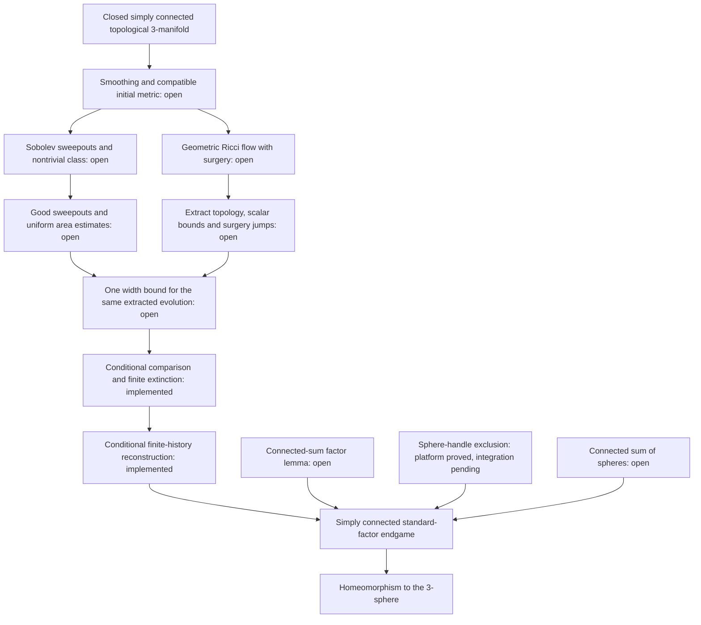

# Poincare formalization: frontier review and first task batch

Reviewed on 2026-09-22 against OpenGA commit
`95c6069fad3dc458d8fd89b2286819881dc23cd2` and live Prove2Me API 0.10.8.
The working tree already contained mission-description edits; those were not
changed by this review. Public observations are recorded in
[the evidence snapshot](frontier-evidence-2026-09-22.json).

## Decision

Use OpenGA for reviewed source and reproducible releases, Prove2Me for scoped
collaborative tasks, and the awards fork for the eventual complete-proof
submission. First repair a newly introduced statement error, integrate an
existing community result, and open a small batch of prerequisite tasks.

This document proposes tasks; it does not publish them or claim their proofs.
The statement audit below has been checked locally. The new task interfaces
are specifications to elaborate before publication, not checked Lean declarations.

## Current evidence

- The live mission root is **Open**.
- The live mission has **17 milestones, 4 marked completed**: scalar lower
  bounds across upward jumps, the integrated area-energy inequality, its
  equality characterization, and parametrized-varifold mass control.
- The live root frontier has **10 open leaves**. Different proof routes share
  this graph; completing every leaf is not a requirement for completing one route.
- The local mirror is dated **2026-09-10**. Its curation report has 77 integrated,
  1 partially integrated and 13 deferred submissions. These are submission
  counts in an old snapshot, not current platform counts or a completion percentage.
- The sphere-handle theorem is now **Proved** on the platform, with an
  **ACCEPTED** submission by **cm_beta** on 2026-09-20. It has not yet been
  incorporated into the local curation ledger.
- `sync.py` explicitly expects API 0.9.9; the live API reports 0.10.8.
  Updating synchronization requires reviewing response compatibility. Merely
  removing the version guard is not an adequate update. This review queried
  public task data without replacing the existing mirror.

Platform status and local kernel verification are recorded separately. This
review did not rerun the whole library build or audit the new handle proof.

## Priority zero: correct the arbitrary-evolution target

The new platform target
[`exists_uniform_area_bound_of_evolution`](https://prove2.me/theorems/4e7712f8-c457-4100-9d0e-91210ea81c7a)
quantifies over **every** `E : SurgeryTopologyEvolution M`.
The type encodes lists of components and reconstruction histories. It imposes
no metric, Ricci equation, surgery geometry or area estimate.

Consequently, it admits the constant evolution

```text
E.components t = [M]  for every real t
E.history T = FiniteSurgeryHistory.refl [M]
```

This evolution never becomes empty. The proposed uniform area data would,
through the existing comparison and extinction theorems, force it to become
empty. This is a contradiction for any `ClosedThreeManifold M`, including
under the proposed simply-connected hypothesis.

[UniformAreaBoundAudit.lean](UniformAreaBoundAudit.lean) constructs this witness
and proves the negation of the universally quantified bound. It imports only
the reusable library, not platform theorem placeholders. The live definitions
of `SurgeryTopologyEvolution` and `SurgeryAreaEvolutionData` match their local
mirrors after whitespace stripping.

The companion target
[`nonempty_surgeryTopologyEvolution`](https://prove2.me/theorems/a2658168-3d62-4579-8ef5-5f13d51d2311)
is inhabited by the same constant evolution, even without simple connectivity.
Its natural-language description as Ricci-flow existence therefore overstates
what its Lean statement establishes.

**Proposed repair:** retain the earlier joint existential target
`exists_area_evolution_surgery_topology` until a geometric flow interface is
available. A later split should construct a geometric flow witness and then
derive uniform estimates for the topology extracted from that same witness.
Do not repair the estimate by adding the desired estimate itself as a hypothesis.
Do not route volunteers to the false universal statement. No platform edit,
disproof submission, comment or deprecation was made during this review.

## Dependency and gap map

The following is the intended extinction route. Arrows describe mathematical
obligations, not a claim that all corresponding platform graph edges exist.



| Layer | Existing work | Remaining obligation |
| --- | --- | --- |
| Analytic comparison | `Analysis/ScalarLowerBound.lean`, `WidthComparison.lean`, `ComparisonExtinction.lean`, `WidthExtinction.lean` | Construct their hypotheses from the intended geometry, uniformly in the final time. |
| Area evolution | `Analysis/Width/AreaEvolution.lean` integrates a common derivative bound; `SurgeryAreaEvolution.lean` packages it | Build actual admissible comparison families, with one time interval and sequence cutoff for all slices. A single-surface variation formula does not supply this. |
| Surface energy and width | `Riemannian/Surface/DirichletEnergy.lean`, `Sweepout.lean`, `Width.lean` | Finite energies and suitable parameter continuity; then the Sobolev mapping-space topology, positivity and comparison with CM width. |
| Surface geometry | Actual induced metric, tangent/normal spaces and pointwise projections; reviewed smooth area variation | Smooth dependence of projections, second fundamental form, induced-connection identification, Gauss-Bonnet and branch-point treatment. |
| Surgery geometry | Abstract volume budgets, finite-event arguments and reconstruction records | Actual neck/cap geometry, flow existence/continuation and estimates that instantiate those records. |
| Topology | Covering-space result and finite connected-sum reconstruction | Integrate handle exclusion; prove simple connectivity passes to connected-sum factors and sums of spheres are spheres. |
| Initial hypotheses | A topological goal and an open smooth-structure target | Supply smoothing and geometric starting data without assuming the original Poincare conclusion. |

The full local Bishop-Gromov milestone remains unlinked on the platform.
The existing complete/nonpositive-model-curvature interface is useful, but
does not by itself establish the milestone's complete local statement.

The alternatives `spherical_cover_of_finite_fundamental_group`,
`homotopy_three_sphere_nonempty_homeomorph` and the smooth Poincare target
contain major mathematical work. They should not be advertised as short
starter lemmas. The two connected-sum targets also require substantial topology:
the definition uses actual coordinate-ball quotients with arbitrary boundary
homeomorphisms, not a symbolic connected-sum operation with the desired laws built in.

## First five task cards

**Updated after reviewing the user-supplied `qinz1yang/gmt` repository:** the
recommended first batch is now **T1, G1, G2, G3, T3**. The GMT task specifications
are in [GMT_REUSE_REVIEW.md](GMT_REUSE_REVIEW.md). G2 depends on G1; G3 can begin
independently and later compose with G2. T2, T4 and T5 remain subsequent task
cards below. T4 follows T3.

Only T1 already has a matching completed platform target. New task statements
need elaboration and downstream links before publication. GMT source and exact
dependency pins have been inspected; its build and axiom audit have not been
rerun in this review. Reuse is a candidate integration, not yet a verified import.

### T1 — Integrate the completed sphere-handle exclusion

- **Type:** review and integration; highest immediate priority.
- **Existing target:** `PoincareFormalization.ExtinctionEndgame.not_simply_connected_sphere_handle`.
- **Evidence:** [theorem](https://prove2.me/theorems/eafa0066-fef6-45ad-87b1-02fc3898b4f8),
  submission `ca2cc8df-2bcf-489e-9219-f4943e83caa1`, author `cm_beta`.
- **Input:** the accepted source, `Topology/CoveringSpace.lean`,
  `Topology/SurgeryReconstruction.lean`, and the pinned Mathlib circle covering.
- **Deliverable:** a library proof that `M.IsSphereHandle` implies
  `¬ SimplyConnectedSpace M`, with its source receipt and author attribution.
- **Review focus:** the source proves simple connectivity descends to a product
  factor, then contradicts injectivity of the periodic circle covering. It also
  repeats a covering-space helper already present in OpenGA; reuse the reviewed
  helper where the signatures agree.
- **Acceptance:** compile and audit the final library declaration; no Open
  theorem imports; update curation with the original submission and source hash.
  Remove the now-unnecessary handle hypothesis from a derived endgame theorem
  while keeping both still-open connected-sum hypotheses explicit.

### T2 — Boundary embeddings for the actual connected-sum construction

- **Type:** topology prerequisite; moderate scope.
- **Input:** `CoordinateBall`, `CoordinateBall.Punctured` and
  `CoordinateBall.boundary` in `Topology/ConnectedSum.lean`.
- **Deliverable:** for `[T2Space M]` and `B : CoordinateBall M`, establish
  continuity and injectivity of `B.boundary`, and bundle it as a closed embedding
  `SphereTwo → B.Punctured`. Identify its range as the chart image of the unit
  sphere, viewed inside the punctured manifold.
- **Proof route:** restrict the chart to the sphere, use injectivity on its source,
  and use compactness of the sphere plus the Hausdorff target for closedness.
- **Acceptance:** use the existing chart and quotient definitions unchanged;
  quantify over arbitrary allowed coordinate balls. Do not assume the embedding
  property that the task is meant to prove.
- **Downstream:** collar/open-cover lemmas for the quotient, followed by the
  connected-sum factor theorem. This task alone proves neither van Kampen nor
  `S3 # S3 ≃ S3`.

### T3 — Finite Dirichlet energy of smooth maps from a compact surface

- **Type:** geometric analysis prerequisite; moderate scope, with a frame issue to review.
- **Input:** `Riemannian/Surface/DirichletEnergy.lean`, the pinned Riemannian
  volume construction and local orthonormal frames.
- **Deliverable:** for a compact smooth boundaryless surface `N`, smooth metrics
  `q` and `g`, and a smooth map `f : N → M` into a finite-dimensional smooth
  Riemannian manifold, prove continuity and integrability of
  `Surface.dirichletDensity q g f`, then derive `dirichletEnergy q g f < ⊤`.
- **Proof route:** express the intrinsic density in a smooth local frame,
  establish agreement with the existing pointwise frame formula, and use a
  finite Riemannian measure on the compact domain.
- **Acceptance:** do not impose immersion or conformality; constant and
  degenerate maps must remain admissible. Integrability is the conclusion, not
  an extra assumption. Keep the existing normalization and measure.
- **Downstream:** finite slice energies for sweepouts and the next task.

### T4 — Uniform finite energy for a regular sweepout

- **Type:** parameter-dependent analysis; depends on T3's energy API.
- **Input:** `SmoothSweepout`, `maxEnergy`, `homotopyWidth` and T3.
- **Deliverable:** for compact `N` and a sweepout whose **actual Dirichlet density**
  is jointly continuous on `[0,1] × N`, prove that the slice-energy function is
  continuous and has a finite attained maximum. Deduce `maxEnergy q g W < ⊤`
  and hence `homotopyWidth q g W < ⊤`.
- **Interface:** make joint density continuity an explicit extra hypothesis in
  this bounded first task. A subsequent theorem must derive it from suitable
  joint regularity of the maps and their differentials.
- **Acceptance:** keep both endpoint slices constant, possibly at different
  points; do not assume energy continuity, a uniform energy bound or the final
  conclusion. `SmoothSweepout` alone only gives joint C0 continuity and smooth
  individual slices; those fields do not justify uniform derivative control.
- **Downstream:** a finite-width API for regular representatives. This does not
  identify smooth width with CM Sobolev width or prove positive width.

### T5 — Local smoothness of the existing normal projection

- **Type:** differential geometry; advanced, assign to an experienced contributor.
- **Input:** `Riemannian/Surface/TangentNormal.lean`, `NormalProjection.lean`,
  `InducedMetric.lean`, and smooth chart/trivialization APIs.
- **Deliverable:** for a smooth immersion and smooth positive-definite ambient
  metric, identify the existing tangent projection in local trivializations
  with `A (Aᵀ G A)⁻¹ Aᵀ G`, and the normal projection with its complement.
  Use full column rank of the differential to prove the Gram matrix invertible
  and the projection matrix smooth on the chart neighborhood.
- **Acceptance:** prove equality with `Surface.normalProjection`; do not
  introduce an unrelated projection or assume its smoothness. State smoothness
  in bundle trivializations so that values at different tangent fibers are
  compared correctly. Scope the first interface to finite-dimensional,
  boundaryless smooth manifolds.
- **Downstream:** the second fundamental form from the actual ambient connection,
  then the induced Gauss equation. The second fundamental form itself is a later task.

## Integration and release rules

1. Before publication, freeze each task's statement, imports, exact toolchain
   and dependency revision. Check milestone history and existing submissions.
2. Use one source branch per task, for example `feat/poincare-boundary-embedding`.
   Review the statement and its connection to a downstream theorem before proof work.
3. Preserve the platform submission ID, original author, source hash, upstream
   licenses, adaptation details and final Git commit in every integration receipt.
4. Verify a library proof without importing `Theorems/Thm_*` placeholders.
   Require the intended statement and an axiom audit allowing only `propext`,
   `Classical.choice` and `Quot.sound`. A successful build of a stub is not a proof.
5. Report task completion and major geometric obligations separately. A completed
   helper or a higher proved-node count does not measure the difficulty remaining.
6. Only when the original root has an unconditional, reproducible proof should
   the awards branch reference the exact complete-proof commit and contributors.

## Reproduction and sources

Run from the OpenGA repository root:

```sh
lake env lean PoincareConjecture/Planning/UniformAreaBoundAudit.lean
python3 PoincareConjecture/sync.py --review-only
```

The first command checks the statement counterexample and prints its axiom
dependencies. The second reads the old local curation snapshot without network
access; it does not certify that the mirror is current.

- [Live mission](https://prove2.me/missions/Formalization%20of%20the%20Poincar%C3%A9%20Conjecture)
- [Prove2Me mission/frontier API documentation](https://prove2.me/references/missions.md)
- [Local foundation review](../References/ColdingMinicozzi/foundation_review.json)
- [Local curation receipts](../curation.json)
- [Colding-Minicozzi, sections 1.1, 1.4 and 1.5](https://arxiv.org/html/0707.0108v1)
- [Kleiner-Lott, surgery and extinction](https://arxiv.org/abs/math/0605667)
- [Awards submission requirements](https://github.com/TheJustinSunPrize/awards/blob/main/CONTRIBUTING.md)
